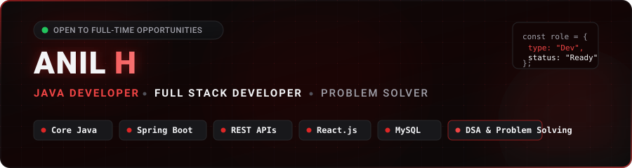

  <!-- Header Banner -->
  

  <!-- Animated Typing Introduction -->
  

    
  

  <!-- Social Badges -->
  

    
    &nbsp;
    
    &nbsp;
    
    &nbsp;
    
  

  <!-- Quick Info Badges -->
  

    
    &nbsp;
    
    &nbsp;
    
    &nbsp;
    
  

  

 

## 👨‍💻 About Me

I am a **Computer Science and Engineering** undergraduate (Graduation: **2026**) from **Yenepoya Institute of Technology** (**CGPA: 8.34**), currently working as a **Full Stack Trainee** at **Strings Stack EduTech Training**.

I specialize in building full-stack applications with **Java**, **Spring Boot**, **React.js**, and **MySQL**. I am continuously improving my problem-solving capabilities through **Data Structures and Algorithms** in Java, while deepening my understanding of backend architecture, secure **RESTful API** development, and database engineering principles. I enjoy learning modern technologies, writing maintainable code, and turning real-world problem statements into functional software products.

 

<table>
  <tr>
    <td width="50%" valign="top">
      <h3>🎯 Profile Overview</h3>
      <ul>
        <li>🎓 <b>Degree:</b> B.E. in Computer Science &amp; Engineering</li>
        <li>🏛️ <b>Institution:</b> Yenepoya Institute of Technology (2022 – 2026)</li>
        <li>📊 <b>Academic Performance:</b> 8.34 CGPA</li>
        <li>💼 <b>Current Position:</b> Full Stack Trainee @ Strings Stack EduTech Training</li>
        <li>📍 <b>Location:</b> Karnataka, India</li>
      </ul>
    </td>
    <td width="50%" valign="top">
      <h3>🚀 Core Technical Focus</h3>
      <ul>
        <li>☕ <b>Language:</b> Core Java &amp; Object-Oriented Programming</li>
        <li>🧩 <b>Problem Solving:</b> Data Structures &amp; Algorithms in Java</li>
        <li>🌱 <b>Backend:</b> Spring Boot &amp; REST API Architecture</li>
        <li>⚛️ <b>Frontend:</b> React.js &amp; Modern UI Frameworks</li>
        <li>🗄️ <b>Database:</b> Relational Modeling &amp; Queries with MySQL</li>
      </ul>
    </td>
  </tr>
</table>

 

  

 

## 🛠️ Technical Skills

  <!-- Skillicons Banner -->
  

 

| Domain | Technologies &amp; Tools |
| :--- | :--- |
| **Programming Languages** | `Java` • `Python` • `JavaScript` |
| **Backend Development** | `Java` • `Spring Boot` • `REST APIs` • `Spring Security` • `JWT` |
| **Frontend Development** | `HTML5` • `CSS3` • `JavaScript` • `React.js` • `Bootstrap` • `Redux Toolkit` |
| **Databases** | `MySQL` • `PostgreSQL` • `MongoDB` |
| **Developer Tools** | `Git` • `GitHub` • `VS Code` • `Postman` • `Google Colab` |
| **Libraries &amp; Frameworks** | `Redux Toolkit` • `JSON` • `JWT` • `Spring Security` • `Pandas` • `OpenCV` • `TensorFlow / Keras` • `Scikit-learn` |

 

  

 

## 💼 Featured Projects

### 🛒 01. B-MART – Full Stack E-Commerce Platform
> **A complete, scalable, and secure full-stack e-commerce solution with integrated payments and role-based access control.**

* **Tech Stack:** `Java` • `Spring Boot` • `React.js` • `Redux Toolkit` • `MySQL` • `Spring Security` • `JWT` • `Razorpay API`
* **Repository:** [anilhosalli18/B-MART_eCommerce_Platform](https://github.com/anilhosalli18/B-MART_eCommerce_Platform)

**Key Features & Engineering Highlights:**
* **End-to-End Architecture:** Full-stack architecture bridging a reactive React & Redux Toolkit UI with a Spring Boot RESTful API and MySQL database.
* **Authentication & Authorization:** Secure user authentication built using **Spring Security** and stateless **JWT** tokens with refresh token rotation and **BCrypt** password hashing.
* **Account Verification:** Integrated **Email OTP verification** pipeline for secure user sign-up and password reset workflows.
* **Product Catalog:** Real-time search, multi-attribute filtering (category, price range), sorting, and efficient server-side pagination.
* **Cart & Wishlist Lifecycle:** User-specific shopping cart state management, persistent wishlist, and customer review & rating system.
* **Secure Payment Processing:** Seamless **Razorpay API** checkout with server-side **HMAC-SHA256 signature verification** to guard against transaction tampering.

---

### 👥 02. Employee Management System
> **An enterprise-grade workforce and department administration system designed with clean architectural patterns.**

* **Tech Stack:** `Java` • `Spring Boot` • `MySQL` • `REST APIs` • `React.js` • `Bootstrap`
* **Repository:** [anilhosalli18/Employee_Management_System](https://github.com/anilhosalli18/Employee_Management_System)

**Key Features & Engineering Highlights:**
* **CRUD Operations:** Comprehensive employee and organizational department management with full data validation.
* **Clean Architecture & DTOs:** Designed RESTful web services implementing **Data Transfer Object (DTO)** patterns to isolate domain entities and optimize payloads.
* **Department Allocation:** Streamlined employee onboarding, role assignments, and organizational hierarchy tracking.
* **Interactive UI:** Responsive dashboard developed with React and Bootstrap featuring live instant search, multi-column sorting, and responsive pagination.
* **Access Control:** Role-based authentication ensuring sensitive administrative functions are isolated.
* **Data Export:** Integrated reporting module allowing single-click export of employee directories and department records to **PDF** and **CSV** files.

---

### 🧠 03. Human Emotion Recognition
> **A multimodal deep learning system combining facial computer vision and physiological signals for emotion classification.**

* **Tech Stack:** `Python` • `TensorFlow / Keras` • `OpenCV` • `Pandas` • `Flask` • `SQLite` • `Scikit-learn`
* **Repository:** [anilhosalli18/Multimodal-Emotion-Recognition](https://github.com/anilhosalli18/Multimodal-Emotion-Recognition)

**Key Features & Engineering Highlights:**
* **Multimodal Processing:** Combined facial image analysis with physiological signal processing for reliable emotional state detection.
* **Deep Learning Architecture:** Utilized **Xception CNN** for facial spatial feature extraction paired with **1D-CNN** models for temporal physiological signal classification.
* **Data Preprocessing Pipeline:** Automated face extraction, image resizing, normalization, and data augmentation pipeline using **OpenCV** and **Pandas**.
* **Web Deployment:** Full-featured **Flask** web application connected to an **SQLite** database for real-time model inference and classification history tracking.
* **Performance Evaluation:** Rigorous model evaluation using **Scikit-learn** metrics including accuracy, precision, recall, and confusion matrix analysis.

 

  

 

## 📈 Currently Learning & Improving

Continuous learning is central to my daily routine. I am actively expanding my knowledge across these areas:

* ☕ **Advanced Core Java:** Deepening understanding of Java memory model (JVM internals), multithreading, concurrency utilities, and modern Java features.
* 📦 **Java Collections Framework & Exception Handling:** Mastering internal mechanics of collections (`HashMap`, `ArrayList`, `ConcurrentHashMap`), equals/hashCode contracts, and robust exception architectures.
* 🧩 **Data Structures & Algorithms:** Practicing foundational patterns (Two Pointers, Sliding Window, Trees, Graphs, Dynamic Programming) to strengthen algorithmic problem solving.
* 🌱 **Spring Boot Ecosystem:** Exploring microservices architecture, Spring Data JPA query optimizations, transaction management, and Spring Security.
* ⚛️ **React.js & Frontend State:** Strengthening state management with Redux Toolkit, custom hooks, and scalable component architecture.
* 🗄️ **Database Management & Optimization:** Indexing strategies, execution plans, query tuning, and ACID transactions in MySQL.

 

  

 

## 📊 GitHub Analytics

  <!-- GitHub Stats and Top Languages Side-by-Side -->
  <table border="0">
    <tr>
      <td align="center" valign="middle">
        
      </td>
      <td align="center" valign="middle">
        
      </td>
    </tr>
  </table>

   

  <!-- GitHub Streak Stats -->
  

 

  

 

## 🧩 LeetCode – Problem Solving Journey

  

    I regularly practice algorithmic problem solving with <b>Java</b> on LeetCode to build strong foundational knowledge in <b>Data Structures and Algorithms</b>.
  

  

    
  

  <!-- LeetCode Dynamic Stats Card -->
  

    

  

    <a href="https://leetcode.com/u/anilhleetcode18">
      <b>👉 Click here to visit my LeetCode Profile: @anilhleetcode18</b>
    </a>
  

 

  

 

## 🐍 Contribution Activity

  

 

  

 

## 📬 Let's Connect

I am actively seeking opportunities as a **Java Developer**, **Full Stack Developer**, or **Software Engineer**. Whether you have a job opportunity, a project to collaborate on, or just want to discuss software engineering, feel free to reach out!

| Platform | Handle / Link | Direct Action |
| :--- | :--- | :--- |
| **GitHub** | [`@anilhosalli18`](https://github.com/anilhosalli18) | [Follow on GitHub](https://github.com/anilhosalli18) |
| **LinkedIn** | [`Anil H`](https://www.linkedin.com/in/anilhosalli18) | [Connect on LinkedIn](https://www.linkedin.com/in/anilhosalli18) |
| **LeetCode** | [`@anilhleetcode18`](https://leetcode.com/u/anilhleetcode18) | [View LeetCode Profile](https://leetcode.com/u/anilhleetcode18) |
| **Email** | [`anilhosalli800@gmail.com`](mailto:anilhosalli800@gmail.com) | [Send an Email](mailto:anilhosalli800@gmail.com) |

 

 

---

  Designed &amp; Engineered with by <a href="https://github.com/anilhosalli18"><b>Anil H</b></a> • Built with Black &amp; Red Aesthetic

